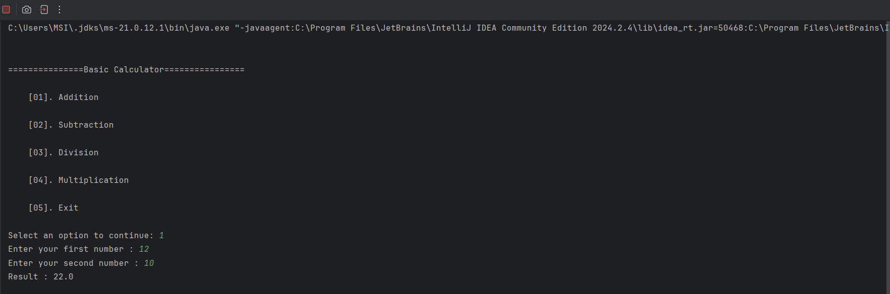
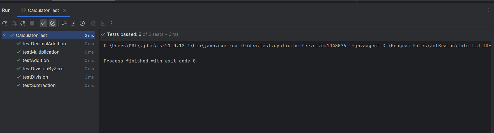

# **JAVA Calculator Application**

## Project Description

This is a basic calculator application developed using JAVA as the part of the Saiket Systems JAVA Development Internship. The application allows users to perform arithmetic operations through a menu-driven interface. 

## Features

* Addition of two numbers
* Subtraction of two numbers
* Division of two numbers
* Multiplication of two numbers
* Menu-driven operation selection
* Repeat calculations until user exist
* Division-by-zero exception handling
* Invalid menu selection handling
* Non-numeric input handling 
* Automated unit tests using JUnit 4
* Verification of expected and actual results

## Technology

* Programming Language: Java
* IDE: IntelliJ IDEA
* Testing Framework: JUnit 4
* Version Control: Git
* Repository Hosting: GitHub

## How to Run the Project

1. Install a Java Development Kit(JDK).
2. Clone or download this repository.
3. Open the project in IntelliJ IDEA.
4. Ensure JUnit 4 is configured as a project dependency.
5. Open Calculator.java to view the calculator implementation.
6. Open CalculatorTest.java.
7. Click the green Run icon beside the test class.
8. Review the test results in IntelliJ IDEA.

## Requirements

* Java Development Kit (JDK)
* IntelliJ IDEA or another Java IDE
* JUnit 4
* Git (for version control)

## Calculator Output

## Testing

The calculator application is tested using **JUnit 4** to verify the correctness of its arithmetic operations and error handling.

### Test Cases

| Test Case | Description | Expected Result |
|---|---|---|
| Addition | Adds two numbers | Correct sum |
| Subtraction | Subtracts the second number from the first | Correct difference |
| Multiplication | Multiplies two numbers | Correct product |
| Division | Divides the first number by the second | Correct quotient |
| Decimal Addition | Adds decimal numbers | Correct decimal result |
| Division by Zero | Attempts to divide by zero | Throws an `ArithmeticException` with an appropriate error message |

### How to Run the Tests

1. Open the project in IntelliJ IDEA.
2. Ensure JUnit 4 is configured in the project.
3. Open `CalculatorTest.java`.
4. Right-click the `CalculatorTest` class.
5. Select **Run 'CalculatorTest'**.
6. Check the test runner for the results.

### Test Results

All six JUnit test cases passed successfully in IntelliJ IDEA.

## Test Results Screenshot

## Author

**Chathurani Thuduwage**

